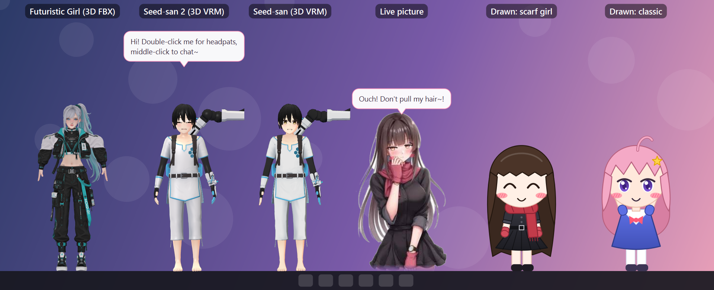
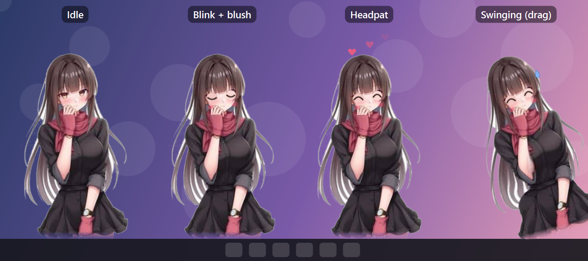
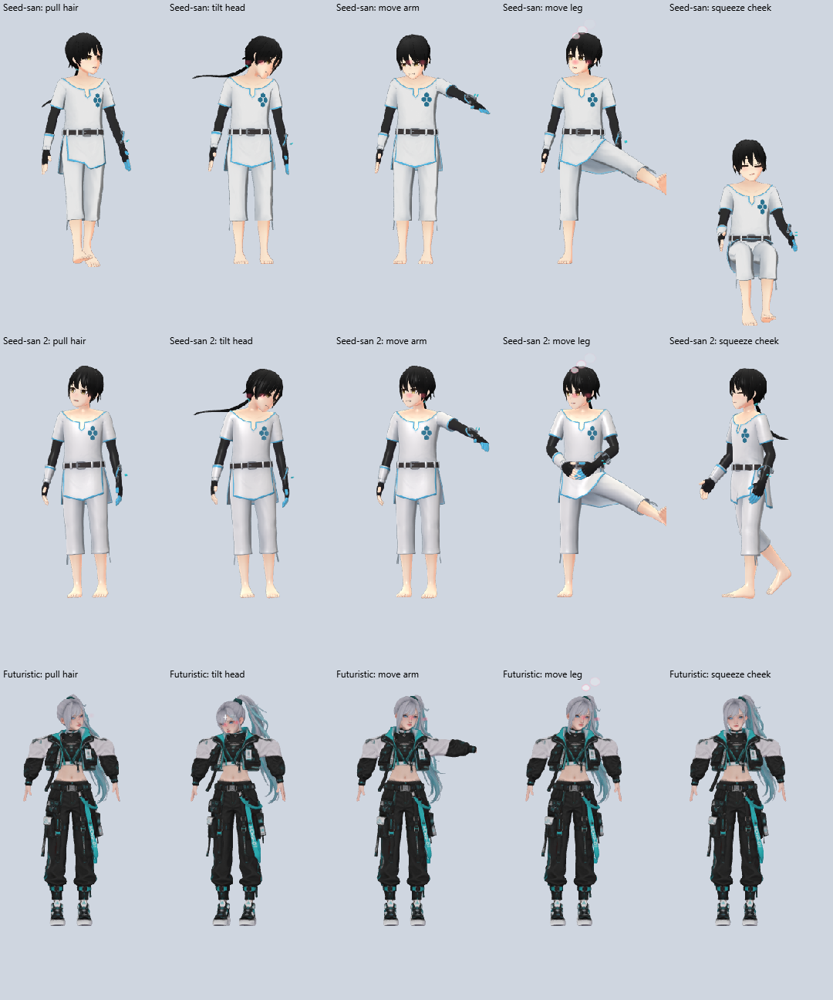
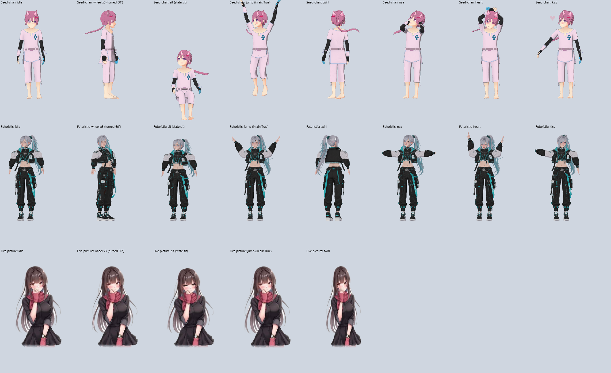
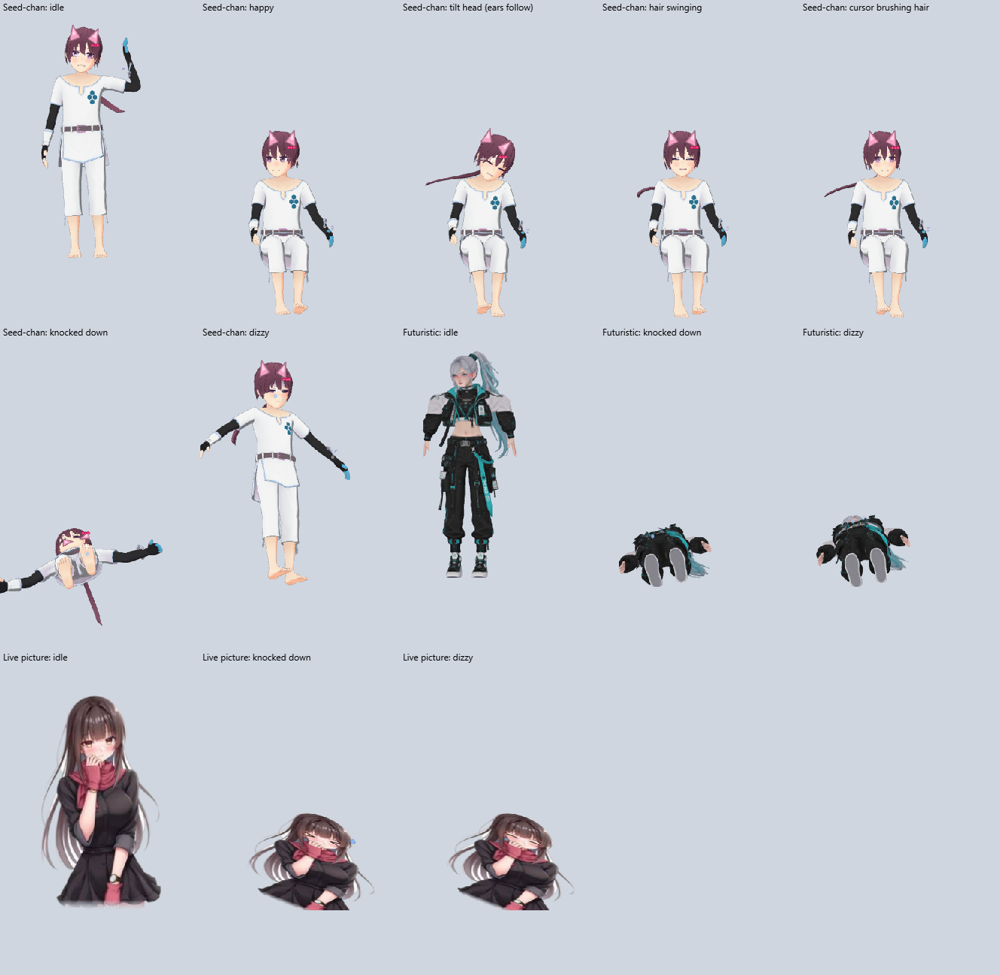
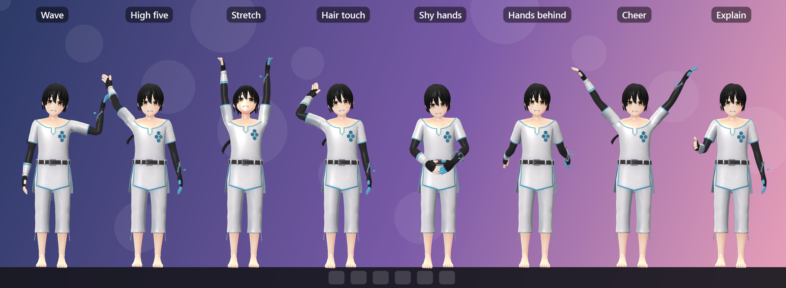

# DesktopWaifu

**An animated anime companion who lives on your Windows desktop.** She walks along your taskbar and
reacts to every touch on every part of her body. She remembers you, sees you through the webcam,
listens to music with you and talks out loud. Her brain is Google Gemini, with an optional offline local model.

<p align="center">
  <a href="https://meshannawod.github.io/desktop-waifu/"></a>
  <a href="https://github.com/MeshanNawod/desktop-waifu/releases/latest"></a>
</p>



<p align="center">
  <b>Python · PySide6 (Qt) · OpenGL · Google Gemini (google-genai) · SQLite · OpenCV · Ollama (optional)</b>
</p>

---

## Contents

- [Download](#download)
- [Quick start (from source)](#quick-start-from-source)
- [Characters](#characters)
- [Touch and gestures](#touch-and-gestures)
- [She learns about you and seeks your attention](#she-learns-about-you-and-seeks-your-attention)
- [Poses, jumping and cute actions](#poses-jumping-and-cute-actions)
- [Hair physics, wind and knock-downs](#hair-physics-wind-and-knock-downs)
- [Lifting by a limb and struggling](#lifting-by-a-limb-and-struggling)
- [64 expressions and moods](#64-expressions-and-moods)
- [Graceful movement and gestures](#graceful-movement-and-gestures)
- [Chat, voice, memory and senses](#chat-voice-memory-and-senses)
- [AI engines](#ai-engines)
- [Project structure](#project-structure)
- [Privacy](#privacy)
- [Troubleshooting](#troubleshooting)

---

## Download

**[⬇ DesktopWaifu-Setup.exe](https://github.com/MeshanNawod/desktop-waifu/releases/latest/download/DesktopWaifu-Setup.exe)**
(Windows 10/11, no admin rights needed) · Website: **https://meshannawod.github.io/desktop-waifu/**

The installer isn't code-signed, so Windows SmartScreen may say "Windows protected your PC": click **More info → Run anyway**.

## Quick start (from source)

1. Install **Python 3.12 or 3.13** from python.org. Tick "Add to PATH" and keep the `py` launcher.
2. Double-click **`setup.bat`**. It creates `.venv` and installs everything in `requirements.txt`.
3. Get a free Gemini API key at <https://aistudio.google.com/apikey>.
4. Double-click **`run.bat`**. On first launch Settings opens, so you can paste the key.
   You can also set the `GEMINI_API_KEY` environment variable instead.

`run.bat debug` keeps a console with live logs. Logs are also written to `%APPDATA%\DesktopWaifu\desktopwaifu.log`.

| Open the chat | Menu | Switch character |
|---|---|---|
| **Middle-click** her, click the tray icon, or right-click → Chat | **Right-click** her or the tray icon | Right-click → **👗 Character** |

---

## Characters

| Character | Type | What makes her special |
|---|---|---|
| **Seed-chan ♡** | 3D VRM variant (`assets/models/Seed-chan.variant.json`) | The cute one: pink hair, pastel outfit, violet sparkly eyes, a slightly bigger head, **cat ears and a bow** that follow her head, soft blush, extra-floppy hair and all the Seed-san 2 movement |
| **Futuristic Girl** | 3D FBX (`assets/models/FuturisticGirl/`) | Detailed scanned mesh, animated procedurally in the shader: head and gaze tracking, shoulder-jointed arms (relaxed from the T-pose), breathing, and spring-wobble physics of the whole body |
| **Seed-san 2** | 3D VRM, realistic mode | Soft lighting, rim light, contact shadow, weight-shift idle, eye micro-movements, curled fingers, idle gestures, waving and high fives |
| **Seed-san** | 3D VRM (backpack hidden via `Seed-san.json`) | Fully rigged: walking legs, sitting on the taskbar edge, spring-bone hair and cloth, facial blend shapes |
| **Live picture** | 2D image warp | Your own picture with hair, scarf and skirt physics, blinking eyelids and gaze tracking |
| **Drawn girls** | 2D vector | Lightweight, with no assets needed |



**Make your own variant:** copy `Seed-chan.variant.json`, then change the `colorize` colours (`[r, g, b, strength, brightness]`
per material), the `bone_scale`, the `accessories` (`cat_ears`, `bow`), the `blush` and the `hair_physics`. It shows up in the Character menu.

**Add your own:**
- Drop a `.vrm` into `assets/models/` (VRoid Studio → *Export VRM*). Every VRM also gets a realistic "2" version.
- Put a `.fbx` and its textures in a folder under `assets/models/`. Add an optional `character.json` such as
  `{"name": "...", "front": "+x", "tpose": true, "arm_down_deg": 76}`.
- To make a picture into a live character, run `tools/make_cutout.py` and copy `assets/characters/scarf_girl/character.json`.

---

## Touch and gestures

**Every body part has its own hitbox, and you can touch it and move it:** head (face), hair, eyes, nose, mouth,
cheeks, hands, legs, body, chest and skirt. Hover over a part and a small hint pops up saying what it does
(Settings → Appearance → *Show what each body part does*).

| Mouse | She… |
|---|---|
| **Short click** | gentle touch: soft smile and a sweet greeting |
| **Press and hold** | **squeeze**: the spot squishes under your finger ("puni♡"), she makes a ><, pouty face, then springs back with a jelly bounce. Cheeks: "Puni puni… m-my cheeks!" Body: "Kyu~ a tight hug!" |
| **Hold too long** (1.8 s) | too hard: "Ow ow ow! Too hard!" She's hurt and her mood drops |
| **Double-click**, or **stroke** back and forth | petting ("athaganawa"): happy closed eyes, blush, hearts; affection rises a lot |
| **Drag her hair** | the hair follows your cursor and springs back when you let go, with a pouty "don't pull my hair~!" |
| **Drag her face / head** | you **tilt and turn her head** |
| **Drag a hand** | **her arm follows your cursor** |
| **Drag a leg** | **her leg lifts toward the cursor** (on rigged models) |
| **Drag her body** | **she leans**; drag far and you **pick her up** |
| **Drag a hand or leg far** | she's **lifted by that limb** and struggles (see below) |
| **Click eyes / nose** | instant blink and squint, a startled flinch, and a cute warning |
| **Chest / skirt** | a gentle stroke gets a shy smile; a sudden touch gets extreme blushing with steam, a recoil and a scolding |




## She learns about you and seeks your attention

- **Attention-seeking** (`waifu/attention.py`): if you're at the PC but ignore her for a few minutes
  (Settings → Senses), she tries to get your attention. She walks over under your cursor and waves, hops and calls you,
  dances cutely, pouts that she's lonely, or asks you a question with Gemini. This escalates every couple of minutes.
- **She learns what works:** every attempt is scored by whether you respond within 45 s. The scores are saved in
  `waifu_memory.db`, and she uses the tactics you react to more often.
- **She learns your habits:** your usual hours at the PC, your favourite ways to interact (headpats, squishing,
  moving her around…), what gets your attention, and facts from your chats. All of this goes into Gemini's
  context, so her personality, topics and timing adapt to you.

## Poses, jumping and cute actions

| How | What she does |
|---|---|
| **Right-drag** on her | **rotate her freely**: left/right spins her round, up/down leans her (a plain right-click still opens the menu) |
| **Mouse wheel** over her (Shift+wheel = lean) | turns her around (and she stays turned) |
| **Tell her** (type or say it): "sit down", "lie down", "kneel", "squat", "bow", "hands up", "salute", "peace sign", "think", "cross your arms", "hands on hips", "dance", "T-pose", "be shy", "stand up"… | she takes that **pose** and holds it until you say "stand up" (also in Right-click → 🧸 Pose & cute → 🧘 Hold a pose). Gemini can pick poses too when you ask in your own words |
| Touch her while she **sits or holds a pose** | she reacts (face, blush, hearts, voice) **without standing up** |
| Right-click → **🧸 Pose & cute** → Sit down / Stand up | she sits on the taskbar edge with her legs dangling, until you stand her up |
| … → Jump! / Hop hop | a real **jump** with gravity, arms up: "Yay~!" |
| … → Twirl | spins all the way around: "Ta-da~ ♪" |
| … → Nya~ / Heart / Blow a kiss / Wave | **cat paws** by her face, **heart arms** over her head, a **kiss** with a flying ♡, a wave |
| … → Turn around / Face me | turns her back to you, or toward you again |
| On her own | when she's happy or playful she does these cute things by herself every now and then |



## Getting angry

Hit her (smack, squeeze too hard, throw a toy at her, or hurt her pet) and she gets **angry**: arms crossed, chin up,
turns her back on you, **steam and a throbbing anger vein**, stomps around and refuses your touches ("Hmph! Don't touch me!").
Some headpats (or saying **sorry**) calm her down. Keep hitting her and she breaks down crying and sulks instead.

## Pets and toys

Right-click → **🐾 Pets & toys** to bring out **Mochi the kitten, Kuri the puppy, Usa the bunny**, a **bouncy ball**,
a **teddy bear** and a **yarn ball**. Each one lives on your desktop with real physics.

- **Pick them up and throw them**; click a pet to boop it; double-click or stroke it to pet it (hearts, purring, wagging).
- **Drop the teddy or a pet on her** and she **hugs it**. Drop the ball on her and she bats it back.
- Pets follow her, chase the ball and yarn, nuzzle her and nap when she naps. **The puppy plays fetch** and brings the ball back to her.
- **She has a life of her own.** Every so often she picks something to do:
  - **pets her pet**: crouches down beside it and strokes its head (it purrs / wags),
  - **cuddles** her pet in her arms, **gives it a treat** (it runs over: "nom nom~"),
  - **plays fetch**: picks up the ball and throws it, the puppy brings it back,
  - rolls the **yarn** for the kitten, kicks the ball around, hugs her teddy,
  - throws a **dance party** (the pets hop along to the beat),
  - and on her own: **reads a book**, has a **cup of tea**, does **jumping jacks**.
- You can ask for any of these: Right-click → 🐾 Pets & toys → **✨ Ask her to…**
- **Throw something hard at her** and it's a bonk: she gets angry. **Hurt a pet** (hold it squeezed, or slam it down) and she gets angry at you.

## Garden: flowers and trees

She plants things on your taskbar and looks after them: **sunflowers, tulips, daisies, sakura, bluebells** in little pots,
and **oak, pine, apple and cherry-blossom trees** in wooden planters. She kneels down to plant a seed, waters it with a
watering can, and it grows over about half an hour: seed → sprout → bud → bloom (trees: sapling → young tree → full tree
with apples or blossoms). Thirsty plants droop and show a water drop until she waters them. The garden is saved and
survives restarts.

- Ask her: *"plant some trees"* (a row of three, **one by one**) or *"plant a flower"*, or Right-click → 🐾 Pets & toys → ✨ Ask her to….
- Click a plant to make it wiggle, stroke or double-click it for hearts.
- **Pull one up or hold it until it's squashed** and it falls over, shedding petals, and she gets **angry**.
  Removing her flowers from the menu makes her angry too.

## Singing, humming and an anime voice

She **hums and sings to herself** now and then (Right-click → 🎵 Sing & voice, or say *"sing me a song"* / *"hum"*).
The humming is a small human-like voice synthesizer (vocal-fold pulses, natural pitch wobble and breath, closed-mouth
"mmm" resonances) singing a new pentatonic tune every time; songs mix hummed phrases with short original lyrics in her
voice. Pick an **anime-girl voice preset** in the same menu (cute, genki, little sister, soft Japanese, Japanese accent).
To make her hum with a real human voice, put a recording of someone humming at
`%APPDATA%\DesktopWaifu\voice\hum_reference.mp3`; she re-pitches its vocal-fold cycles onto every tune
(PSOLA), so it sounds like a person, not an instrument. Otherwise she uses her own anime voice the same way.

## She feels your music

When music plays (and she's allowed to hear it; privacy mode can still allow this, it never leaves your PC):

- she works out the song's **mood** from the sound (tempo, energy, brightness, major / minor key) and **dances on the beat**
  in a matching style: bouncy fist pumps (energetic), side-steps (happy), a slow sway with closed eyes (calm),
  hugging herself (sad), head-bobbing air guitar (intense); her face and comments follow the mood. With Gemini and window
  titles allowed she also thinks about what the song means.
- she **learns the melody** you're listening to and later **hums it** ("that song is stuck in my head~").
  She never copies or replays the actual audio, she hums the tune in her own voice.

## She looks after you

- **Reminders**: *"remind me at 5:30 pm to call mom"*, *"in 20 minutes to stretch"*, *"every day at 8am to take my medicine"*
  (or Right-click → 🩺 Care & reminders). She walks over, waves and tells you, plus a Windows notification.
- **Breaks & health**: after ~50 min of activity she suggests a break, stretches with you and makes tea; reminds you to
  drink water, rest your eyes, and to go to sleep when it's very late.
- **Watch me work** (off until you turn it on; say *"watch me work"*): when you code or do heavy work she shades her eyes,
  squints and peers at your work, offers to help, and invites you for tea after long sessions. It only reads the
  program's name (like `Code.exe`), never window titles or screenshots.

## Privacy

Right-click → **🔒 Privacy**. **Privacy mode** is a master lock: she won't take screenshots, read window titles or
song names, use the webcam or microphone, or listen to your PC's audio. Separate switches control each sense, whether
she **remembers your chats and learns about you**, and **Local AI only** (nothing is sent to the cloud, including her
voice, which then uses the offline Windows voice). *Forget everything about me* wipes her memory.

## Don't shake her!

Shake her hard while holding her and she gets dizzy (swirly eyes, green face)... put her down and she throws up on
the taskbar. She looks at the puddle ("eww..."), then cleans it with a spray bottle and a mop until it's gone.

## Cloth physics

Loose clothing (skirts, tunic flaps, hems) swings when she moves, is dragged, jumps or falls, ripples in the breeze and gusts,
and flicks when you touch her. Tune it per model with `"cloth": {"materials": [...], "softness": 1.0, "flutter": 0.006}` in the model's `.json`.

## Hair physics, wind and knock-downs

- **Hair** is soft, floppy spring physics. It swings when she moves, turns or gets dragged, sways in a **breeze with gusts**,
  is **pushed aside when your cursor brushes through it** (just hovering, no click), and you can grab and pull a whole lock.
- **Touch her too hard**, either a fast **smack** (the cursor slams into her) or a squeeze held far too long, and she's **knocked over**.
  She topples backwards, lies dizzy with **stars circling her head**, then gets back up pouting
  ("Owww… the world is spinning…" / "Hmph! That was mean!"). Petting her helps her up sooner.



## Lifting by a limb and struggling

Grab her by a **hand** and she hangs from it with the arm stretched up. Grab a **leg** and she hangs upside down.
She swings like a pendulum as you move the mouse and **wriggles to get free** ("dagalanawa"): kicking her legs,
flailing her free arm, twisting and shaking her head, with sweat drops and complaints.
The longer you hold her, the harder she struggles. After a few seconds she may **break free** and drop,
and she can't be re-grabbed until you let go of the mouse button. Her hair and clothes keep their spring physics the whole time.


---

## 64 expressions and moods

**8 eye gazes × 8 faces = 64 named expressions** (`waifu/expressions.py`):

- **Gazes:** direct, side glance, shy downcast, upward, half-lidded, closed (^^), sparkle, wink.
- **Faces:** calm, gentle smile, beaming, teasing smirk, pout, blush, startled, sorrowful.

Her **mood** sets which cells she uses. The moods are Happy, Shy, Flustered, Sleepy, Upset, Playful, Struggling and Neutral.
Every few seconds she drifts to another fitting cell, giving micro-expressions, and touches or Gemini's emotion tags snap her to one immediately.
Her eyes and head follow your cursor anywhere on the desktop; a side glance looks away, while a direct gaze follows you.


**State machine** (`waifu/emotion.py`): AWAKE, SLEEPING, HURT (sulking), HAPPY and LISTENING, plus **mood**
(short-term) and **affection** (0–100, long-term). Both are stored in SQLite and shown in the tray tooltip.

| From | To | How |
|---|---|---|
| Awake | **Sleeping** | You're idle for a while (sooner at night), or you say "good night", or use the menu |
| Sleeping | Awake | You click, pat or lift her, open the chat, call her name (with *wake by voice* on), or come back on the webcam |
| any | **Hurt** | You're rough with her. She sits, turns away and sulks |
| Hurt | Awake | Gentle touches comfort her, or you say "sorry" / "samawenna" |
| Awake | **Happy** | Her mood reaches 85 or more |
| Awake | **Listening** | Your PC plays music |

---

## Graceful movement and gestures

She breathes, sways with a natural weight shift, blinks (sometimes twice), and moves her eyes in small saccades.
On Seed-san 2 she also does idle gestures that match her mood: waving when your cursor comes near,
a high five when you tap her hand, stretching, touching her hair, shy clasped hands, hands behind her back,
cheering, and hand gestures while talking.



---

## Chat, voice, memory and senses


- **Chat:** a floating chat panel and speech bubble. Replies carry emotion tags that drive her face.
- **Voice:** 🎤 talks to her; Gemini transcribes. She answers with edge-tts neural voices (or offline Windows SAPI), with lip-sync.
- **Memory** (`%APPDATA%\DesktopWaifu\waifu_memory.db`): saves every message, plus facts about you that Gemini extracts
  (likes, plans, people) and shared moments. "Remember that…" saves a fact straight away.
  View or delete facts in **Settings → Memory**.
- **Webcam** (off by default): face presence detection runs locally. She greets you when you come back.
  "Look at me" / "what am I holding?" sends one frame so she can identify objects.
- **Screen:** 👁 or "look at my screen", plus optional periodic glances (with a blocklist for private windows).
- **Music:** she hears what your PC plays (WASAPI loopback), bobs to the beat with ♪ notes,
  reads the song title from Spotify, YouTube or VLC, and comments on it.
- **Initiative:** after a long silence she starts a conversation, often asking about you.

---

## AI engines

Settings → AI → **AI engine**:

| Engine | Use |
|---|---|
| **Gemini online, local model when Gemini is busy or offline** (default) | Best of both |
| **Gemini online only** | Cloud only |
| **Local downloaded model only** | Offline and private, and no API key needed |

- **Gemini model:** the default is `gemini-3.5-flash`. `gemini-2.5-flash` is retired for new API keys and returns 404.
  On a 503 overload she retries, then falls back to `gemini-3.5-flash-lite`. A retired model is replaced automatically.
- **Local model:** [Ollama](https://ollama.com). Click **Install Ollama…**, choose a model (`gemma3:4b` can also see images), then click **Download model**.

---

## Project structure

```
main.py                    entry point
requirements.txt           dependencies          setup.bat / run.bat   install & launch
waifu/
  waifu_core.py            transparent overlay window: physics, walking, gravity, hitboxes, lifting + struggling
  gestures.py              gesture listener: click / squeeze / double-click / stroke / move / pull / lift
  attention.py             attention-seeking tactics that learn what works on you
  gemini_brain.py          Gemini: chat, vision, audio, STT, memory facts, retries + model fallback
  database.py              SQLite memory: messages, facts, stats, moments (waifu_memory.db)
  emotion.py               state machine + moods + affection
  expressions.py           64-expression matrix and micro-expression engine
  reactions.py             voice lines for every body part and gesture
  app.py                   controller: wires everything, tray, menus, life loop
  local_ai.py              offline brain via Ollama
  vrm/  fbx/               3D loaders + OpenGL renderer (skinning, spring bones, toon shading)
  vrm_character.py         rigged 3D characters (Seed-san, Seed-san 2)
  mesh_character.py        static 3D meshes with procedural animation (Futuristic Girl)
  live_image.py, sprites.py   2D characters
  camera.py, music.py, vision.py, voice.py   senses
  ui/                      speech bubble, chat panel, settings
tools/
  make_cutout.py           picture → transparent character
  make_screenshots.py      regenerates the images in this README
```

---

## Privacy

- **Webcam and periodic screen glances are off by default.** Face presence and beat detection run on your PC.
- Only explicit looks, greetings, song clips you allow, and speech you address to her are sent to Gemini.
- The API key, memories and settings live in `%APPDATA%\DesktopWaifu`. They're never in this repo (see `.gitignore`).

## Troubleshooting

| Problem | Fix |
|---|---|
| "Gemini is overloaded (503)" | Wait a minute, or install a local model in Settings → AI |
| 404 for a model | Choose `gemini-3.5-flash` in Settings → AI |
| Clicks on empty space get blocked | Settings → Appearance → *Force click-through mask* |
| No neural voice | Use Python 3.12 or 3.13 (edge-tts is broken on 3.15); the app falls back to Windows SAPI |
| No mic | Set *Mic device index* (to list devices, run `.venv\Scripts\python -m sounddevice`) |

## Credits

DesktopWaifu stands on the work of many people. Thank you all!

### 3D models and art

| Asset | Author | Source | License |
|---|---|---|---|
| **Futuristic Girl** (`assets/models/FuturisticGirl/`: FBX model and textures) | **FERUL** | [CGTrader item 7216568](https://www.cgtrader.com/items/7216568) | Used under the license of the CGTrader listing. All rights belong to FERUL. |
| **Seed-san** (`assets/models/Seed-san.vrm`, also the base of *Seed-chan*) | **VirtualCast, Inc.** | [VRM Consortium sample models](https://vrm.dev/en/) | [VRM Public License 1.0](https://vrm.dev/licenses/1.0/) (credit required; modification and redistribution allowed) |
| **Seed-chan** (`assets/models/Seed-chan.variant.json`) | recolour and cute variant of Seed-san made for this project | this repo | follows Seed-san's VRM Public License 1.0 |
| **Scarf girl picture** (`assets/characters/scarf_girl/`) | third-party picture provided by the repo owner | | used with permission |
| **Face detector** (`assets/models/haarcascade_frontalface_default.xml`) | Rainer Lienhart, Intel Corporation | [OpenCV](https://github.com/opencv/opencv) | Intel License Agreement for OpenCV (BSD-style) |
| **App icon, pets, toys, plants, website art** | drawn for this project | this repo | same license as the project |

### Services and voices

- **Google Gemini** (`google-genai`), the cloud AI that powers her conversations.
- **Ollama** and the open models it runs (e.g. Google **Gemma 3**), for the offline AI. Each model has its own license.
- **Microsoft Edge neural voices** (Ana, Nanami, Maisie, Ava) via [edge-tts](https://github.com/rany2/edge-tts), and the Windows SAPI voices offline.
- Website font: **M PLUS Rounded 1c** by the M+ Fonts Project (SIL Open Font License), via Google Fonts.

### Open-source libraries

| Library | License | | Library | License |
|---|---|---|---|---|
| [PySide6 / Qt](https://www.qt.io/qt-for-python) | LGPL-3.0 | | [NumPy](https://numpy.org) | BSD-3-Clause |
| [PyOpenGL](https://pyopengl.sourceforge.net) | BSD | | [OpenCV (opencv-python-headless)](https://github.com/opencv/opencv-python) | Apache-2.0 |
| [google-genai](https://github.com/googleapis/python-genai) | Apache-2.0 | | [edge-tts](https://github.com/rany2/edge-tts) | LGPL-3.0 |
| [SoundCard](https://github.com/bastibe/SoundCard) | BSD-3-Clause | | [sounddevice](https://github.com/spatialaudio/python-sounddevice) | MIT |
| [mss](https://github.com/BoboTiG/python-mss) | MIT | | [Pillow](https://python-pillow.org) | MIT-CMU |
| [pyttsx3](https://github.com/nateshmbhat/pyttsx3) | MPL-2.0 | | [comtypes](https://github.com/enthought/comtypes) | MIT |
| [pywin32](https://github.com/mhammond/pywin32) | PSF | | [aiohttp](https://github.com/aio-libs/aiohttp) | Apache-2.0 |
| [certifi](https://github.com/certifi/python-certifi) | MPL-2.0 | | [cffi](https://cffi.readthedocs.io) | MIT-0 |

Installer built with [PyInstaller](https://pyinstaller.org) (GPL-2.0 with the bootloader exception) and
[Inno Setup](https://jrsoftware.org/isinfo.php) by Jordan Russell and Martijn Laan.

### Ideas and research

- Music key / mood detection uses the **Krumhansl–Kessler** key profiles (C. Krumhansl, *Cognitive Foundations of
  Musical Pitch*, 1990).
- Humming uses **TD-PSOLA** pitch shifting (Moulines & Charpentier, 1990) and a **Rosenberg** glottal pulse model
  (A. Rosenberg, 1971).
- Hair and cloth springs follow the **VRM spring bone** design by the VRM Consortium.

If you made something used here and the credit is missing or wrong, please
[open an issue](https://github.com/MeshanNawod/desktop-waifu/issues) and it will be fixed right away.
