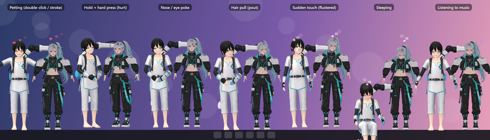
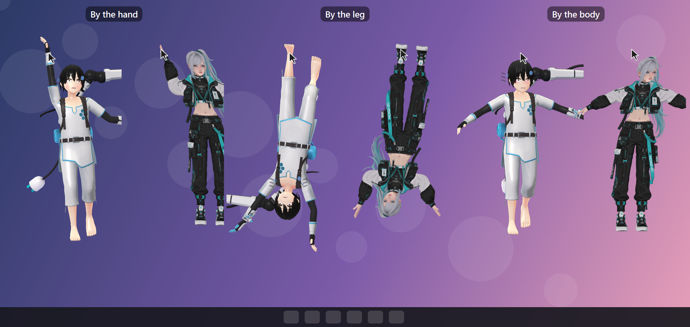
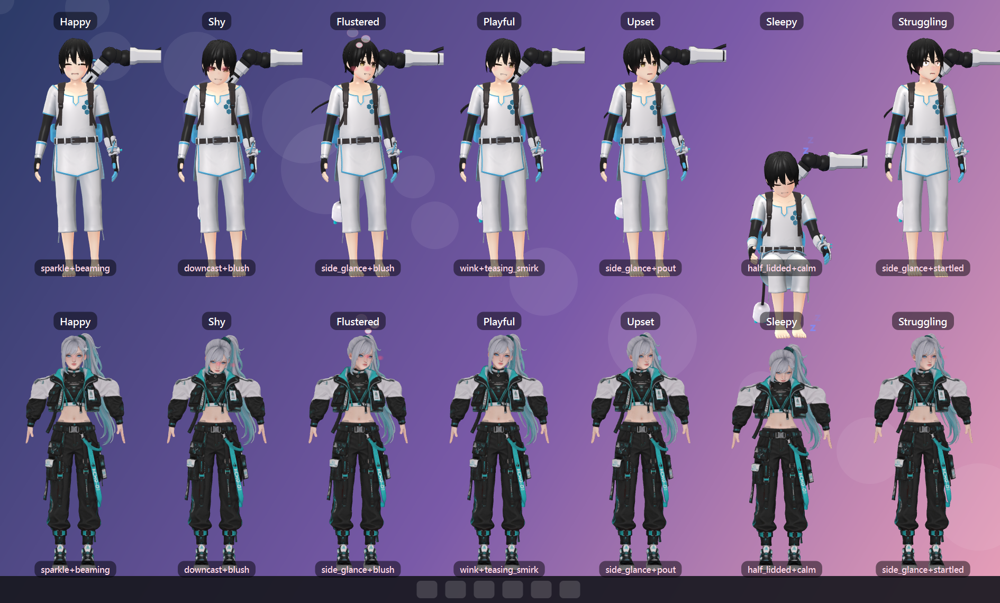
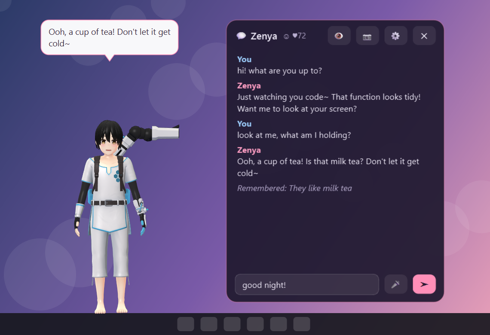

# DesktopWaifu

**An animated anime companion who lives on your Windows desktop.** She walks along your taskbar and
reacts to every touch on every part of her body. She remembers you, sees you through the webcam,
listens to music with you and talks out loud. Her brain is Google Gemini, with an optional offline local model.


<p align="center">
  <b>Python · PySide6 (Qt) · OpenGL · Google Gemini (google-genai) · SQLite · OpenCV · Ollama (optional)</b>
</p>

---

## Contents
- [Quick start](#quick-start)
- [Characters](#characters)
- [Touch and gestures](#touch-and-gestures)
- [Lifting by a limb and struggling](#lifting-by-a-limb-and-struggling)
- [64 expressions and moods](#64-expressions-and-moods)
- [Graceful movement and gestures](#graceful-movement-and-gestures)
- [Chat, voice, memory and senses](#chat-voice-memory-and-senses)
- [AI engines](#ai-engines)
- [Project structure](#project-structure)
- [Privacy](#privacy)
- [Troubleshooting](#troubleshooting)

---

## Quick start

1. Install **Python 3.12 or 3.13** from python.org. Tick "Add to PATH" and keep the `py` launcher.
2. Double-click **`setup.bat`**. It creates `.venv` and installs everything in `requirements.txt`.
3. Get a free Gemini API key at <https://aistudio.google.com/apikey>.
4. Double-click **`run.bat`**. On first launch Settings opens, so you can paste the key.
   You can also set the `GEMINI_API_KEY` environment variable instead.

`run.bat debug` keeps a console with live logs. Logs are also written to `%APPDATA%\DesktopWaifu\desktopwaifu.log`.

| Open the chat | Menu | Switch character |
|---|---|---|
| **Middle-click** her, click the tray icon, or right-click → Chat | **Right-click** her or the tray icon | Right-click → **👗 Character** |

---

## Characters

| Character | Type | What makes her special |
|---|---|---|
| **Futuristic Girl** | 3D FBX (`assets/models/FuturisticGirl/`) | Detailed scanned mesh, animated procedurally in the shader: head and gaze tracking, shoulder-jointed arms (relaxed from the T-pose), breathing, and spring-wobble physics of the whole body |
| **Seed-san 2** | 3D VRM, realistic mode | Soft lighting, rim light, contact shadow, weight-shift idle, eye micro-movements, curled fingers, idle gestures, waving and high fives |
| **Seed-san** | 3D VRM | Fully rigged: walking legs, sitting on the taskbar edge, spring-bone hair and cloth, facial blend shapes |
| **Live picture** | 2D image warp | Your own picture with hair, scarf and skirt physics, blinking eyelids and gaze tracking |
| **Drawn girls** | 2D vector | Lightweight, with no assets needed |


**Add your own:**
- Drop a `.vrm` into `assets/models/` (VRoid Studio → *Export VRM*). Every VRM also gets a realistic "2" version.
- Put a `.fbx` and its textures in a folder under `assets/models/`. Add an optional `character.json` such as
  `{"name": "...", "front": "+x", "tpose": true, "arm_down_deg": 76}`.
- To make a picture into a live character, run `tools/make_cutout.py` and copy `assets/characters/scarf_girl/character.json`.

---

## Touch and gestures

**Every body part has its own hitbox:** head, hair, eyes, nose, mouth, cheeks, hands, legs, body, chest and skirt.
A gesture listener (`waifu/gestures.py`) classifies how you touch, and the emotion engine decides how she feels about it.

| Mouse gesture | Meaning | She… |
|---|---|---|
| **Short click** | gentle touch | smiles softly and greets you sweetly |
| **Long press / hold** (0.55 s) | hard, sudden press ("hayiyen gahanawa") | is startled or hurt and gets defensive; her mood drops and she may sulk |
| **Double-click**, or **stroking** back and forth | petting ("athaganawa") | closes her eyes happily and blushes; hearts appear and affection rises a lot |
| **Drag on her hair** | pulling | pouts cutely: "Ouch! Don't pull my hair~!" Her hair stretches toward the cursor and springs back |
| **Click her eyes or nose** | poke | blinks and squints instantly, flinches back, and gives a cute warning |
| **Chest or skirt: gentle stroke** | trusted, gentle touch | gives a sweet, shy smile; affection goes up |
| **Chest or skirt: click, hold or hit** | sudden or inappropriate | blushes hard (with steam), recoils flustered and scolds you |
| **Drag a hand or leg** | lifting by a limb | dangles from it and **struggles** (see below) |
| **Drag her body** | picked up | swings with your motion; gravity drops her back onto the taskbar |



---

## Lifting by a limb and struggling

Grab her by a **hand** and she hangs from it with the arm stretched up. Grab a **leg** and she hangs upside down.
She swings like a pendulum as you move the mouse and **wriggles to get free** ("dagalanawa"): kicking her legs,
flailing her free arm, twisting and shaking her head, with sweat drops and complaints.
The longer you hold her, the harder she struggles. After a few seconds she may **break free** and drop,
and she can't be re-grabbed until you let go of the mouse button. Her hair and clothes keep their spring physics the whole time.



---

## 64 expressions and moods

**8 eye gazes × 8 faces = 64 named expressions** (`waifu/expressions.py`):

- **Gazes:** direct, side glance, shy downcast, upward, half-lidded, closed (^^), sparkle, wink.
- **Faces:** calm, gentle smile, beaming, teasing smirk, pout, blush, startled, sorrowful.

Her **mood** sets which cells she uses. The moods are Happy, Shy, Flustered, Sleepy, Upset, Playful, Struggling and Neutral.
Every few seconds she drifts to another fitting cell, giving micro-expressions, and touches or Gemini's emotion tags snap her to one immediately.
Her eyes and head follow your cursor anywhere on the desktop; a side glance looks away, while a direct gaze follows you.



**State machine** (`waifu/emotion.py`): AWAKE, SLEEPING, HURT (sulking), HAPPY and LISTENING, plus **mood**
(short-term) and **affection** (0–100, long-term). Both are stored in SQLite and shown in the tray tooltip.

| From | To | How |
|---|---|---|
| Awake | **Sleeping** | You're idle for a while (sooner at night), or you say "good night", or use the menu |
| Sleeping | Awake | You click, pat or lift her, open the chat, call her name (with *wake by voice* on), or come back on the webcam |
| any | **Hurt** | You're rough with her. She sits, turns away and sulks |
| Hurt | Awake | Gentle touches comfort her, or you say "sorry" / "samawenna" |
| Awake | **Happy** | Her mood reaches 85 or more |
| Awake | **Listening** | Your PC plays music |

---

## Graceful movement and gestures

She breathes, sways with a natural weight shift, blinks (sometimes twice), and moves her eyes in small saccades.
On Seed-san 2 she also does idle gestures that match her mood: waving when your cursor comes near,
a high five when you tap her hand, stretching, touching her hair, shy clasped hands, hands behind her back,
cheering, and hand gestures while talking.


---

## Chat, voice, memory and senses



- **Chat:** a floating chat panel and speech bubble. Replies carry emotion tags that drive her face.
- **Voice:** 🎤 talks to her; Gemini transcribes. She answers with edge-tts neural voices (or offline Windows SAPI), with lip-sync.
- **Memory** (`%APPDATA%\DesktopWaifu\waifu_memory.db`): saves every message, plus facts about you that Gemini extracts
  (likes, plans, people) and shared moments. "Remember that…" saves a fact straight away.
  View or delete facts in **Settings → Memory**.
- **Webcam** (off by default): face presence detection runs locally. She greets you when you come back.
  "Look at me" / "what am I holding?" sends one frame so she can identify objects.
- **Screen:** 👁 or "look at my screen", plus optional periodic glances (with a blocklist for private windows).
- **Music:** she hears what your PC plays (WASAPI loopback), bobs to the beat with ♪ notes,
  reads the song title from Spotify, YouTube or VLC, and comments on it.
- **Initiative:** after a long silence she starts a conversation, often asking about you.

---

## AI engines

Settings → AI → **AI engine**:

| Engine | Use |
|---|---|
| **Gemini online, local model when Gemini is busy or offline** (default) | Best of both |
| **Gemini online only** | Cloud only |
| **Local downloaded model only** | Offline and private, and no API key needed |

- **Gemini model:** the default is `gemini-3.5-flash`. `gemini-2.5-flash` is retired for new API keys and returns 404.
  On a 503 overload she retries, then falls back to `gemini-3.5-flash-lite`. A retired model is replaced automatically.
- **Local model:** [Ollama](https://ollama.com). Click **Install Ollama…**, choose a model (`gemma3:4b` can also see images), then click **Download model**.

---

## Project structure

```
main.py                    entry point
requirements.txt           dependencies          setup.bat / run.bat   install & launch
waifu/
  waifu_core.py            transparent overlay window: physics, walking, gravity, hitboxes, lifting + struggling
  gestures.py              gesture listener: click / hold / double-click / stroke / pull / lift
  gemini_brain.py          Gemini: chat, vision, audio, STT, memory facts, retries + model fallback
  database.py              SQLite memory: messages, facts, stats, moments (waifu_memory.db)
  emotion.py               state machine + moods + affection
  expressions.py           64-expression matrix and micro-expression engine
  reactions.py             voice lines for every body part and gesture
  app.py                   controller: wires everything, tray, menus, life loop
  local_ai.py              offline brain via Ollama
  vrm/  fbx/               3D loaders + OpenGL renderer (skinning, spring bones, toon shading)
  vrm_character.py         rigged 3D characters (Seed-san, Seed-san 2)
  mesh_character.py        static 3D meshes with procedural animation (Futuristic Girl)
  live_image.py, sprites.py   2D characters
  camera.py, music.py, vision.py, voice.py   senses
  ui/                      speech bubble, chat panel, settings
tools/
  make_cutout.py           picture → transparent character
  make_screenshots.py      regenerates the images in this README
```

---

## Privacy

- **Webcam and periodic screen glances are off by default.** Face presence and beat detection run on your PC.
- Only explicit looks, greetings, song clips you allow, and speech you address to her are sent to Gemini.
- The API key, memories and settings live in `%APPDATA%\DesktopWaifu`. They're never in this repo (see `.gitignore`).

## Troubleshooting

| Problem | Fix |
|---|---|
| "Gemini is overloaded (503)" | Wait a minute, or install a local model in Settings → AI |
| 404 for a model | Choose `gemini-3.5-flash` in Settings → AI |
| Clicks on empty space get blocked | Settings → Appearance → *Force click-through mask* |
| No neural voice | Use Python 3.12 or 3.13 (edge-tts is broken on 3.15); the app falls back to Windows SAPI |
| No mic | Set *Mic device index* (to list devices, run `.venv\Scripts\python -m sounddevice`) |

## Credits

- **Seed-san:** VRM Consortium sample model (VRM Public License 1.0).
- **Face detection:** OpenCV Haar cascade (Apache 2.0).
- **Futuristic Girl** and the scarf-girl picture are third-party assets provided by the repo owner.
